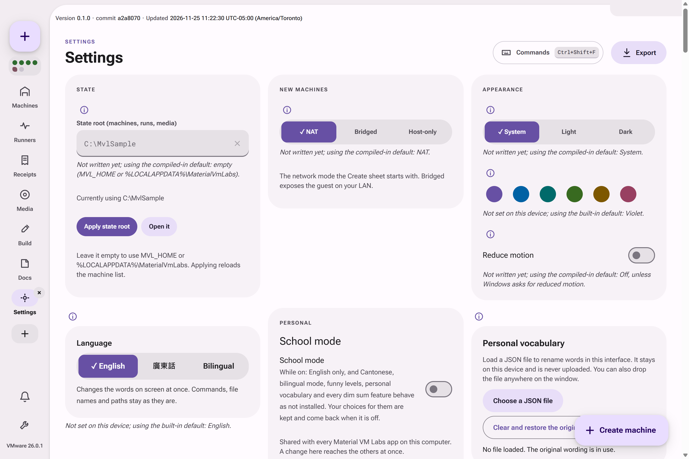
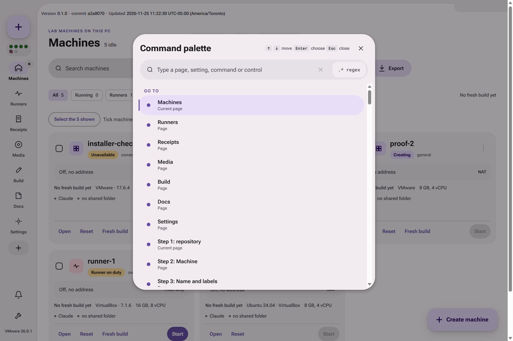
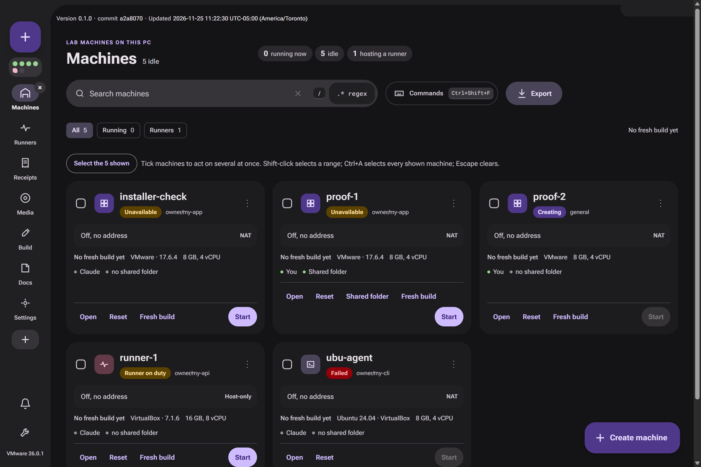

# Material VM Labs

Throwaway Windows 11, Windows Server 2025, Ubuntu and Debian machines, installed unattended from
official evaluation media, for proving that a repository's `build.bat`, `build-installer.bat` and
installers really work on a fresh host with no dependencies. A lab machine can also host a
self-hosted GitHub Actions runner for a **private** repository.

**Documentation site: https://ding-ding-projects.github.io/material-vm-labs/**

**Install:** download `MaterialVmLabsSetup.exe` from the
[latest release](https://github.com/Ding-Ding-Projects/material-vm-labs/releases/latest). It is not
code-signed, so Windows may show an unknown-publisher warning.

**Build and run from source on a fresh Windows 10 or 11 PC** (no tools installed beforehand):

```powershell
.\build.bat --run
```

It fetches every dependency at a pinned version and checks its SHA-256, runs the tests, builds the
portable apps, checks that the output matches the committed source, and only then starts the
manager (`dist\MaterialVmLabs-<version>.exe`, unsigned). The installer is built separately with
`build-installer.bat`.


<sub>The built manager on a hidden desktop, with five sample machines in a throwaway state folder and no hypervisor attached, so every card shows Off and no address.</sub>

**Contents:** [What it does](#what-it-does) · [Quick start](#quick-start) ·
[Screenshots](#screenshots) · [Documentation](#documentation) · [Builds and releases](#builds-and-releases) ·
[Size of the project](#size-of-the-project) · [Contributing](#contributing) ·
[Shared engineering instructions](#shared-engineering-instructions)

## What it does

- **VMware Workstation first, VirtualBox fallback**, chosen and reported every run.
- **One command to a ready machine**: unattended install, guest tools, clean baseline snapshot.
- **Fresh-environment receipts**: a fresh clone at an exact commit, entrypoints run with `/s`,
  logs, artifacts and every dependency the build had to download, all bound to that commit.
- **Fast CLI for agents** (`mvl`, terse lines, `--json`) and a keyboard **TUI** for you.
- **Material 3 apps**: the manager, a documentation reader and a build GUI, with light, dark and
  system themes, six seed colours and reduced motion.

<details>
<summary>More features: Remote Desktop, networking, secrets, personal vocabulary, updates</summary>

- **Remote Desktop pre-opened**, the IP on every listing, NAT or bridged with an automatic NAT
  fallback, and your own guest sign-in (default password `1234`).
- **No secrets in the answer-file template**: placeholders only; each machine's guest password is
  DPAPI-protected in its own folder, and the seed image is deleted after use.
- **Personal vocabulary**: load or drop your own JSON file (`{"schemaVersion": 1, "entries": {...}}`)
  to rename words in the apps and on the site. It stays on your device; Clear restores the wording.
- **Updates**: the installed manager checks the release feed in the background, verifies the
  package hashes and shows a banner with **Restart to install update** and **Later**. A build still
  being made shows as **Update coming soon** with its real stages.

Every feature and its honest status: [docs/features/README.md](docs/features/README.md).

</details>

## Quick start

```bat
mvl.bat install-cli                      :: puts `mvl` on PATH (per-user, no PATH edit)
mvl hv                                   :: which hypervisor will be used and why
mvl up proof-1 --project my-repo         :: create (first time) or reset+start
mvl rdp proof-1                          :: Remote Desktop, already signed in
```

<details>
<summary>More commands: media, IP address, networking, fresh builds, removal, TUI, state folder</summary>

```bat
mvl media                                :: fetch or re-check the official evaluation ISO
mvl ip proof-1                           :: its IP address
mvl net proof-1 bridged                  :: own LAN address (falls back to NAT if none arrives)
mvl build proof-1 --repo owner/name --entry build,build-installer --evidence evidence\receipts
mvl rm proof-1 --yes                     :: destroy it all
mvl tui                                  :: interactive manager
```

State lives in `%LOCALAPPDATA%\MaterialVmLabs` (override with `MVL_HOME` or `--home`). Every
command: [docs/reference/cli.md](docs/reference/cli.md).

</details>

## Screenshots

<details>
<summary>Screenshots: settings, phone width, command palette and the documentation site</summary>

| Settings: appearance, language, vocabulary, motion | Phone width: bottom navigation bar |
| --- | --- |
|  |  |

| Command palette (Ctrl+Shift+F) | Documentation site |
| --- | --- |
|  |  |

| Dark theme | |
| --- | --- |
|  | |

All app screenshots are captured from the built manager (2026-11-25) with sample machines, not a
live host. Earlier screenshots are in the [screenshot archive](SCREENSHOT_ARCHIVE.md).

</details>

## Documentation

The [documentation site](https://ding-ding-projects.github.io/material-vm-labs/) has guided tasks,
interactive walkthroughs, one article per feature and a phone-size PDF edition. In this
repository, start at [docs/README.md](docs/README.md).

<details>
<summary>Documentation in this repository: getting started, fresh builds, runners, reference, features</summary>

- [Getting started](docs/getting-started/README.md): create, manage and set up lab machines, and Linux machines.
- [Fresh builds](docs/building/README.md): fresh-host receipts and installer tests.
- [Self-hosted runners](docs/runners/README.md): a runner for a private repository.
- [Reference](docs/reference/README.md): the CLI, media verification, hypervisors and the security model.
- [Features](docs/features/README.md): every feature, its own article and its honest status.

</details>

## Builds and releases

<details>
<summary>Builds, releases, silent mode, dependencies and updates</summary>

- `build.bat` builds everything; `build-installer.bat` builds the unsigned Squirrel.Windows
  installer. Both run with no prompt with `/s`, `--silent` or `SILENT=1`, and both call
  `download-dependencies.bat` first.
- `download-dependencies.bat` (Windows) and `download-dependencies.sh` (Linux and macOS) fetch
  every pinned dependency listed in [dependencies.json](dependencies.json), check its SHA-256, and
  keep it in a per-user folder. Fetched files never go into the repository.
- GitHub Actions builds and tests every push on `windows-latest` and publishes a uniquely tagged
  release with the portable apps, the installer, the zip, the PDF documentation and the SHA-256 of
  every file. Releases are **not code-signed**, so Windows SmartScreen may warn.
- The installed manager updates itself from those releases, only after you choose
  **Restart to install update**.

Status: [ROADMAP.md](ROADMAP.md) · Changes: [CHANGELOG.md](CHANGELOG.md) · Handoff notes:
[HANDOFF.md](HANDOFF.md)

</details>

## Size of the project

<details>
<summary>Line counts and an estimate of how long a person would take to write it</summary>

Every release's notes carry two sections produced by the same workflow run at the tagged commit:

- **Lines of code**: source, tests, styles and markup, documentation and generated files counted
  separately, with total and non-blank lines and the agent and people split, from
  `node scripts/count-lines.mjs`.
- **How long a person would take (estimate)**: a labelled range, its inputs (the non-blank source,
  test and markup lines from that count), the assumed rates and one line of arithmetic, from
  `node scripts/human-time-estimate.mjs`. It is an estimate, not a measurement, and it leaves out
  generated files, lock files, fonts, images, PDFs and design frames exactly as the count does.

No release has published both figures yet, so this README does not quote a number. Once one does,
its figures may be copied here with the release they came from.

</details>

## Contributing

Read [CONTRIBUTING.md](CONTRIBUTING.md) and [AGENTS.md](AGENTS.md). Security problems go through
[SECURITY.md](SECURITY.md). Everyone follows the [code of conduct](CODE_OF_CONDUCT.md).

## Shared engineering instructions

<details>
<summary>Shared engineering instructions (sanitized mirror)</summary>

This repository follows the maintainer's shared engineering instructions. A sanitized mirror, with
every machine, account, host, address, path and credential detail generalized, is kept in
[AGENTS.md](AGENTS.md#working-on-material-vm-labs) under "Shared engineering instructions
(sanitized mirror)". It is a copy: changes are made in the canonical instructions first.

In short: plan and design before building; prove a change works by running it and report what was
not checked; never fake data or results; keep every screen accessible, localized and honest about
empty, offline and error states; pin dependencies with digests; never commit secrets; publish
unsigned releases with their hashes, line counts and a labelled time estimate; and install updates
only when the person chooses to.

</details>
