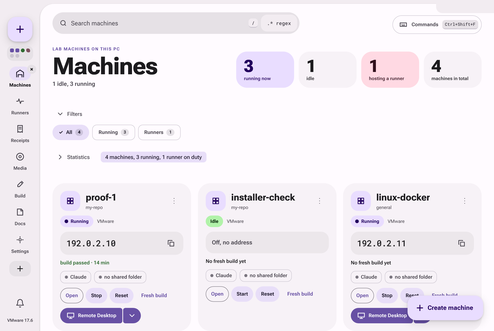
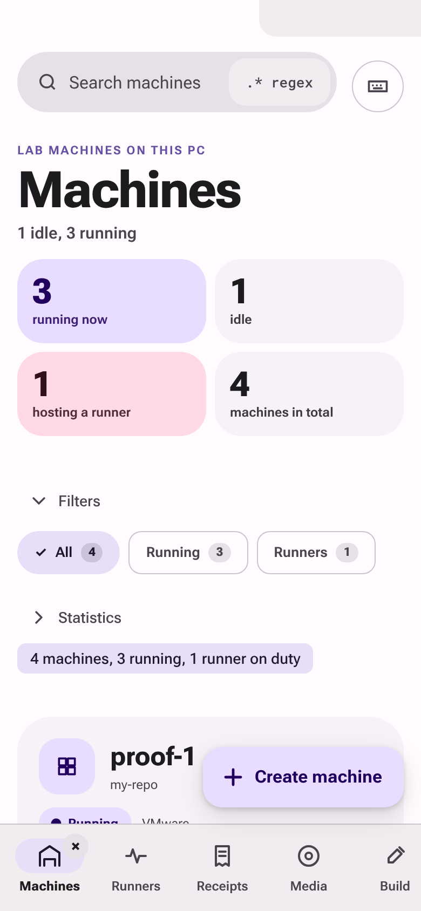
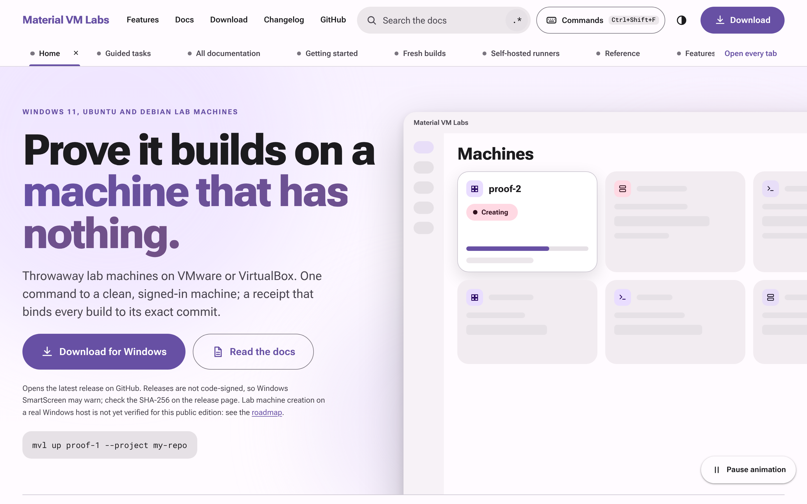

# Material VM Labs

**Documentation site: https://ding-ding-projects.github.io/material-vm-labs/**

Throwaway Windows 11, Windows Server 2025, Ubuntu and Debian machines, installed unattended from
official evaluation media, for proving that a repository's `build.bat`, `build-installer.bat` and
installers really work on a fresh host with no dependencies. A lab machine can also host a
self-hosted GitHub Actions runner for a **private** repository.



<sub>The manager rendered with sample machines (documentation IP range), not a live host.</sub>

- **VMware Workstation first, VirtualBox fallback**, chosen and reported every run.
- **One command to a ready machine**: unattended install, guest tools, clean baseline snapshot.
- **Fresh-environment receipts**: a fresh clone at an exact commit, entrypoints run with `/s`,
  logs, artifacts and every dependency the build had to download, all bound to that commit.
- **Fast CLI for agents** (`mvl`, terse lines, `--json`) and a keyboard **TUI** for you.
- **Remote Desktop pre-opened**, the IP on every listing, NAT or bridged with an automatic NAT
  fallback, and your own guest sign-in (default password `1234`).
- **No secrets in the answer-file template**: placeholders only; each machine's guest password is
  DPAPI-protected in its own folder, and the seed image is deleted after use.

- **Material 3 apps**: the manager, a documentation reader and a build GUI, with light, dark and
  system themes, six seed colours and reduced motion.
- **Personal vocabulary**: load or drop your own JSON file (`{"schemaVersion": 1, "entries": {...}}`)
  to rename words in the apps and on the site. It stays on your device; Clear restores the wording.

## Screenshots

| Settings: appearance, language, vocabulary, motion | Phone width: bottom navigation bar |
| --- | --- |
|  |  |

| Command palette (Ctrl+Shift+F) | Documentation site |
| --- | --- |
|  |  |

All app screenshots are rendered with sample machines, not a live host. Earlier screenshots are in the
[screenshot archive](docs/images/ARCHIVE.md).

## Fresh Windows: build and run

```bat
build.bat
```

Silent (GitHub Actions, scheduled tasks, agents): `build.bat /s`. Installer: `build-installer.bat /s`.

## Quick start

```bat
mvl.bat install-cli                      :: puts `mvl` on PATH (per-user, no PATH edit)
mvl hv                                   :: which hypervisor will be used and why
mvl media                                :: fetch or re-check the official evaluation ISO
mvl up proof-1 --project my-repo      :: create (first time) or reset+start
mvl ip proof-1                           :: its IP address
mvl rdp proof-1                          :: Remote Desktop, already signed in
mvl net proof-1 bridged                  :: own LAN address (falls back to NAT if none arrives)
mvl build proof-1 --repo owner/name --entry build,build-installer --evidence evidence\receipts
mvl rm proof-1 --yes                     :: destroy it all
mvl tui                                  :: interactive manager
```

State lives in `%LOCALAPPDATA%\MaterialVmLabs` (override with `MVL_HOME` or `--home`).

## Documentation

The [documentation site](https://ding-ding-projects.github.io/material-vm-labs/) has guided tasks, interactive
walkthroughs, every article and a phone-size PDF edition. In this repository, 
start at [docs/README.md](docs/README.md): creating a lab machine, fresh-build receipts, self-hosted
runners, the CLI, media verification, hypervisor behaviour and the security model.

## Builds and releases

GitHub Actions builds and tests every push on `windows-latest` and publishes tagged releases with
the portable apps, the installer, the zip and the PDF docs. Releases are **not code-signed**, so
Windows SmartScreen may warn.

Status: [ROADMAP.md](ROADMAP.md) · Changes: [CHANGELOG.md](CHANGELOG.md)
